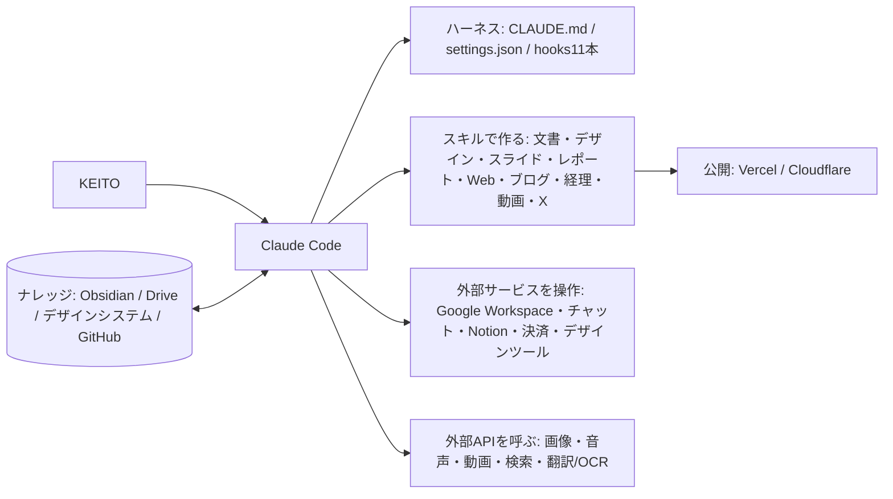

# アーキテクチャ

## hooks 一覧(11本)
01 session-start / 02 prompt-context / 03 bash-guard / 04 secret-file-guard / 05 publish-confirm / 06 post-edit-format / 07 post-secret-scan / 08 post-edit-log / 09 pre-compact / 10 stop-notify / 11 session-end
